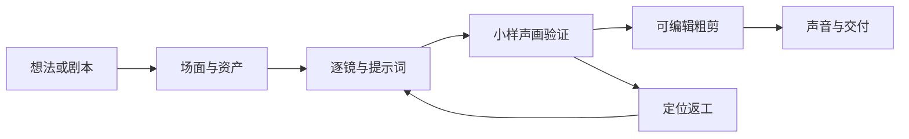

# Drama Craft · 漫剧制作流程与 Agent Skill

从故事想法、现成剧本或已有素材开始，用同一份流程推进剧本、资产、导演分镜、图片／视频提示词、声音、剪辑、验收与返工。

An agent skill and a Chinese production playbook for narrative AI video. Includes 27 reusable prompts and a dependency-free Python utility. No model or generation credits are bundled.

当前版本：0.2.0（预览版）。流程与工具可用；模型执行、声线、口型和成片观感仍需真实项目验证，不承诺一键自动出片。

## 先用哪一份

- 给AI助手使用：[SKILL.md](SKILL.md)。
- 直接阅读或复制提示词：[完整制作流程](references/workflow.md)。
- 许可与上游署名：[ATTRIBUTION.md](references/ATTRIBUTION.md)。



## 安装为 Skill

只安装Skill可下载[v0.2.0安装ZIP](https://github.com/yangcunbang2026-web/drama-craft/releases/download/v0.2.0/drama-craft-v0.2.0.zip)，解压后把`drama-craft`目录放入宿主支持的skills目录，保留其中署名与许可；已有同名私人版本请勿直接覆盖。ZIP只含可安装Skill，不包含CLI。

使用离线CLI或从源码安装，需要Git和Python 3.10+：

```sh
git clone https://github.com/yangcunbang2026-web/drama-craft.git
cd drama-craft
python scripts/drama_craft.py validate
```

Codex 的常见安装位置，PowerShell 示例：

```powershell
python scripts/drama_craft.py install --destination "$env:USERPROFILE/.codex/skills/drama-craft"
```

macOS／Linux 示例：

```sh
python3 scripts/drama_craft.py install --destination "$HOME/.codex/skills/drama-craft"
```

安装器只复制 Skill、正文、署名、UI元数据和许可证，目标已存在会停止，不覆盖已有私人版本。其他支持 SKILL.md 的助手可安装到自身支持的目录；未提供专属适配的客户端按其文档配置。新会话中调用 `$drama-craft`；工具发现方式取决于宿主。

不安装也能把流程正文交给助手，再附自己的brief和剧本。

## 三种开始方式

```text
使用 $drama-craft。我的想法是……。请先发展为可制作逐场剧本，标明新提案，暂不生成媒体。
```

```text
使用 $drama-craft。这里是已确认剧本。保留原句，完成这一场的资产需求、逐镜卡和已填好的图片／视频提示词。
```

```text
使用 $drama-craft。这里是实际源片和问题位置。只修影响剧情的错误，保留可靠部分并复核相邻镜。
```

## 命令行工具

工具负责组织文件和提示词，真实写作与生成由你的助手及工具完成。只使用Python标准库，不读取账户、不联网、不触发付费任务。

```sh
# 建立新的制作主单目录；已有目录不覆盖
python scripts/drama_craft.py init ./projects/demo --idea "维修店的取件单与封袋编号不符"

# 列出27套提示词；从正文单一来源提取
python scripts/drama_craft.py prompts
python scripts/drama_craft.py prompt T10 --context ./projects/demo/PROJECT.md

# 结构、相对链接、许可和常见泄漏模式检查
python scripts/drama_craft.py validate

# 可安装的Skill ZIP，输出到被Git忽略的dist目录
python scripts/drama_craft.py pack --output dist/drama-craft-skill.zip

# 本地测试，和GitHub Actions使用同一套检查
python -m unittest discover -s tests -v
```

`prompt`只输出模板及所给上下文，不调用模型或自动填写；助手须先完成分析与编译，再将适配的正文交给实际生成工具。

初始化的主单包含制作约定、剧本位置、资产、逐镜卡、实际任务和检查状态。文字设计、媒体生成、可剪区间和完整声画验收分开记录。

## 内容与适配范围

主线收为6个制作阶段；开工、返工与参考维护提供支持，共9个主章节。保留T00—T26完整提示词、虚构示例、源段接镜及验收依据。增加节拍轻重、可选静态联排、制作量取舍和工程可迁移交付。镜数、时长、音轨路线和平台由brief与真实能力决定。

已有工程和可靠素材直接继承。没有知识库连接也能执行；有知识库时按项目权限取当前来源。媒体上传、付费、声音使用和发布按具体项目授权。CI检查结构与包完整性，不判断电影观感或真人口型质量。

## 贡献

欢迎提交可复现的失败案例、具体修改和对应适用范围。提交前运行validate与测试，删除私人台词、素材路径、账户信息和未获发布权内容。只描述真正检查过的项目；整体认可不能证明每个变量各自有效。

## 许可

手册、Skill及提示词：[CC BY 4.0](LICENSE)，可以在署名和标记修改的条件下分享与改编，包括商业使用。CLI与测试脚本：[MIT](LICENSE.code)。请保留[第三方署名](references/ATTRIBUTION.md)。其他人的素材、声音、模型或服务不受本仓库许可替代。
